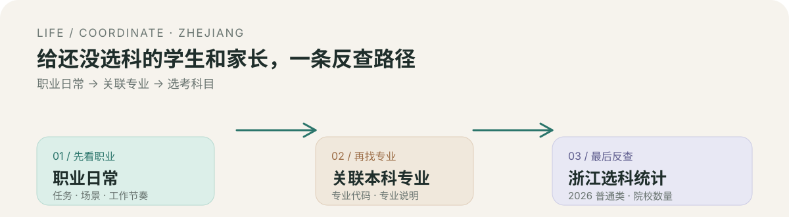

# life-coordinate

> 从职业日常开始，找到你的职业方向、关联专业与选科参考。

  

## 这是什么

`life-coordinate` 面向浙江高中未选科学生及其家长的"职业 → 专业 → 选考科目"反向查询工具。（数据来源：浙江省 2026 年普通类招生计划中的院校专业数据）。

它适合用来：

- 查看每个专业在浙江院校样本中的选科组合分布；
- 按已选科目反查符合院校要求的专业；
- 浏览职业的任务、场景和工作节奏；
- 通过职业反查关联专业；

## 目标人群

- 正在了解职业方向的高中生；
- 对高考机制有模糊认知，不知道如何给学生提供方向的家长；
- 不了解专业和未来职业方向，以至于没有明确的选科方向；

## 当前边界

本项目目前只适用于浙江统考考生，艺术生不适用；
这是一个参考与探索工具，不是录取资格判断器。职业与专业之间是探索关联；具体招生专业、选科条件、体检、外语语种和录取规则，应以目标院校当年公开的招生计划和招生章程为准。
